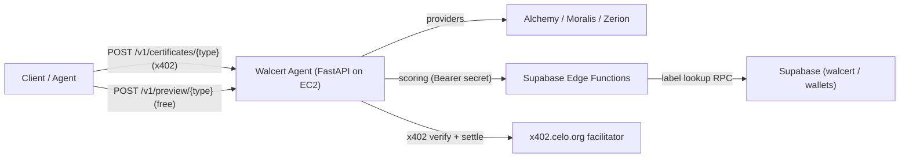

# Walcert Agent

**Walcert Agent** is an [ERC-8004](https://eips.ethereum.org/EIPS/eip-8004) agent on **Celo**, built by **Global Score Agent**, that issues **A–F wallet-maturity certificates** through real-time analysis (*hot-analysis*). It is designed for server-to-server (agent-to-agent) consumption over HTTP JSON, with payments settled via the **x402** protocol.

- On-chain identity: **agentId `9699`** on the ERC-8004 Identity Registry `0x8004A169FB4a3325136EB29fA0ceB6D2e539a432` (Celo), owner `0x475F589BD4bFe82b333b8006dcc278f393b8E124`.
- Public base URL: `https://walcert.globalscoreagent.com`
- Agent / payTo wallet: `0xF4D938200445B0Df0f028af6d90D016147AEd095`

## What it does

Given a wallet address, the agent runs a fresh analysis and returns a signed certificate graded **A–F**. There are four certificate types:

| Type | What it certifies | Data provider |
|------|-------------------|---------------|
| `origins` | Source of funds (CEX, bridges, mixers, OFAC) and mixing risk | Alchemy + labeled address tables |
| `activity` | Recent activity, counterparties and wash-trading / circular patterns | Alchemy + labeled address tables |
| `multichain` | Multi-network presence, consistency and longevity (incl. Celo) | Moralis (+ Celo via Alchemy) |
| `portfolio` | Portfolio composition, liquidity and concentration (HHI) | Zerion |

All certificate texts (`summary`, `grade_label`, `strengths`, `concerns`) are **bilingual** (`{ "eng": "...", "esp": "..." }`).

Full business documentation:
- English: [docs/certificates-en.md](docs/certificates-en.md)
- Español: [docs/certificados-es.md](docs/certificados-es.md)
- JSON schemas: [docs/certificate-json-schemas.md](docs/certificate-json-schemas.md)
- Edge Function security: [docs/edge-function-security.md](docs/edge-function-security.md)

## Architecture



The agent fetches raw data from the providers, forwards it to the corresponding Supabase Edge Function for scoring (authenticated with a shared secret), and returns the graded certificate.

## Endpoints

| Method | Path | Auth | Description |
|--------|------|------|-------------|
| GET | `/health` | none | Liveness check |
| GET | `/v1/quota` | none | Provider quota snapshot |
| POST | `/v1/preview/{type}` | none | **Free** preview: A–F grade only |
| POST | `/v1/certificates/{type}` | **x402** | Full signed certificate |

`{type}` is one of `origins`, `activity`, `multichain`, `portfolio`. Request body:

```json
{ "wallet_address": "0x..." }
```

## x402 payments (Celo mainnet)

The `/v1/certificates/*` endpoints are protected by an x402 paywall (Track 2 of the Celo Agentic Payments & DeFAI Hackathon):

| Field | Value |
|-------|-------|
| Network | `eip155:42220` (Celo mainnet) |
| Asset | USDC `0xcebA9300f2b948710d2653dD7B07f33A8B32118C` |
| Price | `$0.05` |
| Pay to | `0xF4D938200445B0Df0f028af6d90D016147AEd095` |
| Scheme | `exact` (gasless EIP-3009) |
| Facilitator | `https://api.x402.celo.org` |

Flow: a request without payment returns `402` with the payment requirements; the client signs an EIP-3009 authorization and retries with the `X-PAYMENT` header; the agent verifies and settles via the facilitator and returns `200` with the certificate. Settled payments are logged to `walcert.x402_payments` through a dedicated Edge Function (the Supabase service role key never leaves the Edge).

See [scripts/x402_buyer_test.py](scripts/x402_buyer_test.py) for a reference buyer.

## ERC-8004 identity

Registration document: [agent/registration.json](agent/registration.json) (pinned to IPFS via Pinata).

- `agentURI` points to the pinned registration JSON on IPFS.
- Update the on-chain URI with [scripts/set_agent_uri.py](scripts/set_agent_uri.py) (signed by the agentId owner).
- Re-pin metadata/logo with [scripts/pin_agent_metadata.py](scripts/pin_agent_metadata.py) (requires `PINATA_JWT`).

## Local setup

```bash
cd walcert_agent
python -m venv .venv
# Windows:
.venv\Scripts\activate
# macOS/Linux:
# source .venv/bin/activate
pip install -r requirements.txt
copy .env.example .env    # cp on macOS/Linux
# Fill in: ALCHEMY_API_KEY, MORALIS_API_KEY, ZERION_API_KEY, EDGE_SHARED_SECRET, ...
uvicorn server:app --host 0.0.0.0 --port 8000
```

Key environment variables (see [.env.example](.env.example)):

- Providers: `ALCHEMY_API_KEY`, `ALCHEMY_NETWORKS`, `MORALIS_API_KEY`, `ZERION_API_KEY`
- Edge scoring: `SUPABASE_FUNCTIONS_URL`, `EDGE_SHARED_SECRET`, `EDGE_SCORING_ENABLED`
- x402: `X402_ENABLED`, `X402_NETWORK`, `X402_FACILITATOR_URL`, `X402_FACILITATOR_API_KEY`, `X402_PAY_TO`, `X402_PRICE`
- Payment logging: `PAYMENT_LOG_ENABLED`, `PAYMENT_LOG_SLUG`

> `EDGE_SHARED_SECRET` must match the value configured in the Supabase Edge Functions secrets. Never commit real secrets: `.env` and `*.pem` are git-ignored.

## Examples

```bash
# Health
curl -s https://walcert.globalscoreagent.com/health

# Free preview (grade only)
curl -s -X POST https://walcert.globalscoreagent.com/v1/preview/origins \
  -H "Content-Type: application/json" \
  --data '{"wallet_address":"0x1822438e03542b3a31cd39f434fbd7f0b9eaf7bd"}'

# Full certificate (returns 402 without an x402 payment)
curl -s -X POST https://walcert.globalscoreagent.com/v1/certificates/origins \
  -H "Content-Type: application/json" \
  --data '{"wallet_address":"0x1822438e03542b3a31cd39f434fbd7f0b9eaf7bd"}'
```

## Free-tier quotas (defaults)

| Provider | Limit | Unit |
|----------|-------|------|
| Zerion | 2,000 / day | calls |
| Moralis | 40,000 / day | CU (`50 CU × chains`) |
| Alchemy | 30,000,000 / month | CU (`120 CU` per `alchemy_getAssetTransfers`) |

Usage is persisted in `data/quota_usage.json` (git-ignored).

## Deployment

The agent runs on an AWS EC2 instance behind a Cloudflare Tunnel (stable public HTTPS at `walcert.globalscoreagent.com`), managed by `systemd` (`uvicorn server:app` on `127.0.0.1:8000`). Helper scripts live under [deploy/](deploy/).

## Project structure

```text
server.py                     # FastAPI app + x402 + payment logging wiring
app/
  config.py                   # Settings from env
  models.py                   # Pydantic models
  services.py                 # Orchestration (providers -> edge scoring)
  payments.py                 # x402 paywall (Celo)
  payment_log.py              # x402 settlement logging middleware
  routes/certificates.py      # /v1/preview + /v1/certificates + /health
  providers/                  # alchemy, moralis, zerion, edge_scoring, quota, cache
supabase/functions/           # Edge Functions (scoring) + _shared helpers
agent/registration.json       # ERC-8004 registration document
docs/                         # Certificate business docs + schemas
scripts/                      # register / set_agent_uri / pin metadata / x402 buyer / e2e
```

## License

Proprietary — Global Score Agent. All rights reserved.
