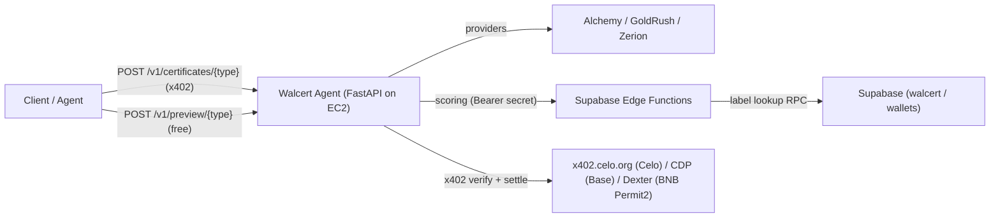

# Walcert Agent

**Walcert Agent** is an [ERC-8004](https://eips.ethereum.org/EIPS/eip-8004) agent on **Celo**, built by **Global Score Agent**, that issues **A–F wallet-maturity certificates** through real-time analysis (*hot-analysis*). It is designed for server-to-server (agent-to-agent) consumption over HTTP JSON, with payments settled via the **x402** protocol.

- On-chain identity: **agentId `9699`** on the ERC-8004 Identity Registry `0x8004A169FB4a3325136EB29fA0ceB6D2e539a432` (Celo), owner `0x475F589BD4bFe82b333b8006dcc278f393b8E124`.
- Public base URL: `https://walcert.globalscoreagent.com`
- Agent / payTo wallet: `0xF4D938200445B0Df0f028af6d90D016147AEd095`

## What it does

Given a wallet address, the agent runs a fresh analysis and returns a signed certificate graded **A–F**. There are four certificate types:

| Type | What it certifies | Data provider |
|------|-------------------|---------------|
| `origins` | Source of funds — **`origins-v2.2`**: 9 signals, value-relevant coverage, concentration in grade | Alchemy + DefiLlama + labels |
| `activity` | Recent activity — **`activity-v2.1`**: 15d window, 11 signals, HHI D@0.70 | Alchemy + DefiLlama + labels |
| `multichain` | Multichain — **`multichain-v2.1`**: footprint / longevity / sampled intensity (public) | GoldRush (Celo native) |
| `portfolio` | Portfolio — **`portfolio-v2.2`**: dual totals credible/raw, HHI, tiers | Zerion |

**Summit alias:** `POST /v1/summit/certificates/multichain-v2` is the same GoldRush `multichain-v2.1` pipeline (Summit auth, no x402). See [docs/bsg2026-summit.md](docs/bsg2026-summit.md).

All certificate texts (`summary`, `grade_label`, `strengths`, `concerns`) are **bilingual** (`{ "eng": "...", "esp": "..." }`).

Full documentation:
- Deployment & onboarding (deploy this project): [docs/deployment-guide.md](docs/deployment-guide.md)
- Identity (agentId 9699 alignment): [docs/identity.md](docs/identity.md)
- Business docs — English: [docs/certificates-en.md](docs/certificates-en.md)
- Business docs — Español: [docs/certificados-es.md](docs/certificados-es.md)
- JSON schemas: [docs/certificate-json-schemas.md](docs/certificate-json-schemas.md)
- Edge Function security: [docs/edge-function-security.md](docs/edge-function-security.md)
- Virtuals ACP adapter (internal channel): [docs/virtuals-acp.md](docs/virtuals-acp.md)
- Summit BSG2026 channel (dedicated key, no x402, expires 2026-08-01): [docs/bsg2026-summit.md](docs/bsg2026-summit.md)
- Concordium CIS-8004 registration: [docs/concordium-cis8004.md](docs/concordium-cis8004.md) · runbook: [docs/concordium-ops-runbook.md](docs/concordium-ops-runbook.md) · public card: `/agent-card.json`
- CDP Bazaar / agentic.market discovery: [docs/cdp-bazaar.md](docs/cdp-bazaar.md)
- BNB x402 (Permit2) + receipt NFT: [docs/bnb-x402-receipt.md](docs/bnb-x402-receipt.md)
- Bankr runtime (thin skill, not x402 Cloud wrap): [docs/bankr-skill.md](docs/bankr-skill.md) · public install: [GlobalScoreAgent/walcert-skill](https://github.com/GlobalScoreAgent/walcert-skill)

## Architecture



The agent fetches raw data from the providers, forwards it to the corresponding Supabase Edge Function for scoring (authenticated with a shared secret), and returns the graded certificate.

## Endpoints

| Method | Path | Auth | Description |
|--------|------|------|-------------|
| GET | `/` | none | **Agent card** JSON (bilingual eng/esp) — discovery, not a UI |
| GET | `/.well-known/ai-tool/{slug}.json` | none | **ERC-8257** Tool Manifest (origins/activity/multichain/portfolio) |
| GET | `/health` | none | Liveness check |
| GET | `/v1/quota` | none | Provider quota snapshot |
| POST | `/v1/preview/{type}` | none | **Free** preview: A–F grade only (`origins`/`activity`; IP rate-limited) |
| POST | `/v1/certificates/{type}` | **x402** | Full signed certificate |
| POST | `/v1/verify` | none | Public hybrid verify by `tx_hash` (DB + Celo + EIP-712 via Edge) |

ERC-8257 toolIds (Owner-registered): **Base** origins `485` / activity `486` / multichain `487` / portfolio `488`; **Ethereum** `163`–`166` (Agent City). ERC-8004 Eth agentId `50032` (Celo `9699` unchanged). See [docs/erc8257-tools.md](docs/erc8257-tools.md).

`{type}` for **paid** certificates is one of `origins`, `activity`, `multichain`, `portfolio`. Free preview only allows `origins` and `activity` (`multichain`/`portfolio` → 403). Request body:

```json
{ "wallet_address": "0x..." }
```

Verify a paid certificate with only the on-chain receipt hash (no original JSON required):

```bash
curl -sS -X POST https://walcert.globalscoreagent.com/v1/verify \
  -H "Content-Type: application/json" \
  -d '{"tx_hash":"0x..."}'
```

The agent is a thin facade: Supabase Edge Function `walcert-certificate-verify` looks up `walcert.certificate_requests` by `onchain_tx_hash`, confirms `NewFeedback` on Celo, and checks the EIP-712 signature. Dashboard / other UIs should call this same endpoint (do not reimplement Celo RPC).

Offline CLI (JSON in hand): `python scripts/verify_certificate.py path/to/certificate.json`.

## x402 payments (Celo + Base + BNB)

The `/v1/certificates/*` endpoints are protected by an x402 paywall. A request without payment returns **402**; the client pays on **one** network.

| Field | Celo (Track 2) | Base | BNB |
|-------|----------------|------|-----|
| Network | `eip155:42220` | `eip155:8453` | `eip155:56` |
| Asset | USDC 6 dec | USDC 6 dec | Binance-Peg USDC 18 dec `0x8AC76a51cc950d9822D68b83fE1Ad97B32Cd580d` |
| Price | `$0.05` | `$0.05` | `$0.05` (`5e16` atomic) |
| Pay to | `0xF4D938200445B0Df0f028af6d90D016147AEd095` | same EOA | same EOA |
| Scheme | `exact` (EIP-3009) | same | `exact` **Permit2** |
| Facilitator | `https://api.x402.celo.org` | CDP | Dexter `https://x402.dexter.cash` |

`accepts[0]` is **Base** (CDP Bazaar). Celo is second. **BNB is third** (`X402_BNB_ENABLED=true` in prod). After a BNB settle the JSON includes `certificate.receipt` (EIP-712 voucher). The **payer** calls `claim` on the soulbound NFT [`0x4e430fB5…24c7`](https://bscscan.com/address/0x4e430fB5A5f26ED08eC123373Cd8AD3cE15C24c7). Mint `From` is the zero address; **gas is paid by the claimant** (not the $0.05 USDC). Celo `giveFeedback` is unchanged. Details: [docs/bnb-x402-receipt.md](docs/bnb-x402-receipt.md).

See [scripts/x402_buyer_test.py](scripts/x402_buyer_test.py) (`X402_NETWORK=eip155:42220`, `eip155:8453`, or `eip155:56`).

## CDP Bazaar / agentic.market

Paid routes declare Python-opt-in Bazaar discovery (`extensions.bazaar`). CDP indexes a resource after a **settled** Base payment through the CDP facilitator (Celo/Track 2 does not count). Catalog listing can take a few minutes after settle.

- Validate (no API key): `POST https://api.cdp.coinbase.com/platform/v2/x402/validate`
- Catalog UI: [agentic.market](https://agentic.market/?q=walcert)
- First Base settle (2026-08-17): origins indexed — [tx `0xfae8a5c6…4216`](https://basescan.org/tx/0xfae8a5c6e5b12aec49472fe547a40cb069be81b43ae4e10fdbf0bd4023924216)
- 30 days without a CDP settle → delist. Details: [docs/cdp-bazaar.md](docs/cdp-bazaar.md)

## On-chain verifiable certificates

Paid certificates are made highly verifiable with two layers (added by the agent after the Edge computes `data_hash`, so the hash is unchanged):

1. **EIP-712 signature** by the agent's signer wallet over the `data_hash` (instant, gasless authenticity) — field `signature`.
2. **Per-certificate on-chain anchor** on the ERC-8004 **Reputation Registry** on Celo (`0x8004BAa17C55a88189AE136b182e5fdA19dE9b63`) via `giveFeedback` — field `onchain`. `feedbackHash` carries the `data_hash` and `value`/`value_decimals` carry the amount paid, so `getSummary(agentId, "certificate_issued")` yields both the issued count and cumulative revenue.

The `giveFeedback` call is sent from a **dedicated monitor wallet** that must differ from the agentId owner (the registry forbids self-feedback from owner/operators) and should also differ from the payTo wallet, since its key lives hot on the server (it only needs a little CELO for gas).

Verify any certificate independently:

- **HTTP (canonical):** `POST /v1/verify` with `{ "tx_hash": "0x..." }` — Edge does DB + Celo + EIP-712.
- **CLI (offline):** `python scripts/verify_certificate.py path/to/certificate.json` — recovers the EIP-712 signer and confirms the on-chain `NewFeedback` event with `feedbackHash == data_hash`.

## ERC-8004 identity

Registration document: [agent/registration.json](agent/registration.json) (pinned to IPFS via Pinata).

- `agentURI` points to the pinned registration JSON on IPFS.
- Update the on-chain URI with [scripts/set_agent_uri.py](scripts/set_agent_uri.py) (signed by the agentId owner).
- Re-pin metadata/logo with [scripts/pin_agent_metadata.py](scripts/pin_agent_metadata.py) (requires `PINATA_JWT`).

## Local setup

```bash
cd walcert_agent
python -m venv .venv
# Windows:
.venv\Scripts\activate
# macOS/Linux:
# source .venv/bin/activate
pip install -r requirements.txt
copy .env.example .env    # cp on macOS/Linux
# Fill in: ALCHEMY_API_KEY, GOLDRUSH_API_KEY, ZERION_API_KEY, EDGE_SHARED_SECRET, ...
uvicorn server:app --host 0.0.0.0 --port 8000
```

Key environment variables (see [.env.example](.env.example)):

- Providers: `ALCHEMY_API_KEY`, `ALCHEMY_NETWORKS`, `GOLDRUSH_API_KEY`, `ZERION_API_KEY`
- Edge scoring: `SUPABASE_FUNCTIONS_URL`, `EDGE_SHARED_SECRET`, `EDGE_SCORING_ENABLED`
- x402: `X402_ENABLED`, `X402_NETWORK`, `X402_FACILITATOR_URL`, `X402_FACILITATOR_API_KEY`, `X402_PAY_TO`, `X402_PRICE`, `X402_BASE_ENABLED`, `COINBASE_API_KEY_BASE`, `COINBASE_SECRET_BASE`
- Payment logging: `PAYMENT_LOG_ENABLED`, `PAYMENT_LOG_SLUG`
- On-chain verifiability: `CELO_RPC_URL`, `REPUTATION_REGISTRY_ADDRESS`, `CERT_SIGNING_ENABLED`, `ONCHAIN_ANCHOR_ENABLED`, `AGENT_SIGNER_KEY` (dedicated monitor wallet), `CERT_SIGNER_ADDRESS`, `CELO_CONFIRMATION_TIMEOUT`, `ONCHAIN_LOG_ENABLED`

> `EDGE_SHARED_SECRET` must match the value configured in the Supabase Edge Functions secrets. Never commit real secrets: `.env` and `*.pem` are git-ignored.
> `AGENT_SIGNER_KEY` is the hot monitor/signer wallet (must NOT be the agentId owner `0x475F…` nor an approved operator; ideally distinct from the payTo `0xF4D9…`). `AGENT_PRIVATE_KEY` (owner) is only for admin scripts, never used at runtime.

## Examples

```bash
# Health
curl -s https://walcert.globalscoreagent.com/health

# Free preview (grade only)
curl -s -X POST https://walcert.globalscoreagent.com/v1/preview/origins \
  -H "Content-Type: application/json" \
  --data '{"wallet_address":"0x1822438e03542b3a31cd39f434fbd7f0b9eaf7bd"}'

# Full certificate (returns 402 without an x402 payment)
curl -s -X POST https://walcert.globalscoreagent.com/v1/certificates/origins \
  -H "Content-Type: application/json" \
  --data '{"wallet_address":"0x1822438e03542b3a31cd39f434fbd7f0b9eaf7bd"}'
```

## Free-tier quotas (defaults)

| Provider | Limit | Unit |
|----------|-------|------|
| Zerion | 2,000 / day | calls |
| GoldRush | 500 / day | analyses (circuit-breaker, not a billing cap) |
| Alchemy | 30,000,000 / month | CU (`120 CU` per `alchemy_getAssetTransfers`) |

Usage is persisted in `data/quota_usage.json` (git-ignored).

## Deployment

The agent runs on an AWS EC2 instance behind a Cloudflare Tunnel (stable public HTTPS at `walcert.globalscoreagent.com`), managed by `systemd` (`uvicorn server:app` on `127.0.0.1:8000`). Helper scripts live under [deploy/](deploy/).

For a full step-by-step deployment (Supabase objects, Edge Functions, secrets, wallets, x402, on-chain and EC2/Cloudflare), see the **[Deployment & Onboarding Guide](docs/deployment-guide.md)**.

## Project structure

```text
server.py                     # FastAPI app + x402 + payment logging + internal access
app/
  config.py                   # Settings from env
  models.py                   # Pydantic models
  services.py                 # Orchestration (providers -> edge scoring -> certify)
  internal_access.py          # Marketplace + Summit Bearer auth + attribution context
  payments.py                 # x402 paywall (Celo + Base/CDP + optional BNB Permit2)
  payment_log.py              # x402 settlement logging middleware
  onchain.py                  # EIP-712 signing + ERC-8004 giveFeedback anchoring
  onchain_log.py              # Background client: persist onchain block to Supabase
  routes/certificates.py      # /v1/preview + /v1/certificates + /health
  providers/                  # alchemy, goldrush, zerion, edge_scoring, quota, cache
supabase/functions/           # Edge Functions (scoring, payment-log, onchain) + _shared
integrations/virtuals-acp/    # ACP serve handlers (marketplace adapter)
agent/registration.json       # ERC-8004 registration document
docs/                         # Deployment guide + certificate business docs + schemas
scripts/                      # register / set_agent_uri / pin metadata / x402 buyer / e2e / verify_certificate
```

## License

Proprietary — Global Score Agent. All rights reserved.
