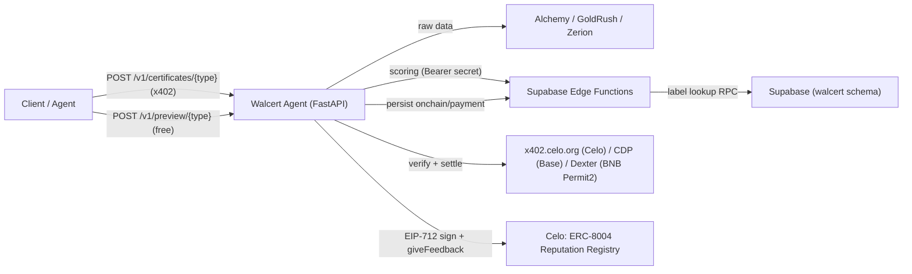

# Walcert Agent — Deployment & Onboarding Guide

Audience: **another agent/operator** who wants to deploy this project (or a fork of it)
end-to-end. It documents every moving part — the FastAPI agent, the Supabase Edge
Functions, the database objects, the wallets, x402 payments and on-chain
verifiability — and the exact order to bring them up.

> This guide is written to be self-contained. Read it top-to-bottom the first time.
> For business context of what each certificate means, see
> [certificates-en.md](certificates-en.md) / [certificados-es.md](certificados-es.md).
> For the JSON shape of a certificate, see [certificate-json-schemas.md](certificate-json-schemas.md).
> For the Edge security model, see [edge-function-security.md](edge-function-security.md).

---

## 1. System overview



Data flow for a paid certificate:

1. Client `POST /v1/certificates/{type}` → agent returns `402` with x402 requirements.
2. Client signs an EIP-3009 (gasless) USDC authorization and retries with `X-PAYMENT`.
3. Agent verifies + settles the payment through the facilitator.
4. Agent fetches raw wallet data from the provider(s) for that certificate type.
5. Agent forwards the raw data to the matching **Edge Function** (Bearer secret) which
   computes the A–F grade and the `data_hash`.
6. Agent **signs** `data_hash` (EIP-712) and **anchors** it on the ERC-8004 Reputation
   Registry via `giveFeedback` (from the dedicated monitor wallet).
7. Agent returns the full certificate (with `signature` + `onchain` blocks).
8. In the background the agent posts the settled payment to `walcert-payment-log` and the
   on-chain result to `walcert-certificate-onchain`, which persist to Supabase.

The **preview** endpoint (`/v1/preview/{type}`) is free, returns grade-only for
`origins` and `activity` only (rate-limited by IP), and never signs, anchors or logs
payments. Preview of `multichain` / `portfolio` returns 403.

---

## 2. Component inventory

### Agent (this repo — runs on your server)

| File | Role |
|------|------|
| `server.py` | FastAPI app; wires x402 paywall + payment-log middleware; `GET /` agent card |
| `app/agent_card.py` | Bilingual discovery JSON for `GET /` (not a human dashboard) |
| `app/config.py` | All settings, read from environment |
| `app/services.py` | Orchestration: providers → edge scoring → certify (sign + anchor) |
| `app/routes/certificates.py` | `/health`, `/v1/quota`, `/v1/preview/{type}`, `/v1/certificates/{type}`, `/v1/verify` |
| `app/providers/` | `alchemy`, `goldrush`, `zerion`, `edge_scoring`, `quota`, `cache` |
| `app/payments.py` | x402 paywall install (Celo + optional Base/CDP) |
| `app/payment_log.py` | Middleware that logs settled x402 payments |
| `app/onchain.py` | EIP-712 signing + ERC-8004 `giveFeedback` anchoring |
| `app/onchain_log.py` | Background client that persists the on-chain block to Supabase |
| `app/certificate_verify.py` | Thin client for Edge `walcert-certificate-verify` (public `/v1/verify` facade) |
| `agent/registration.json` | ERC-8004 registration document (pinned to IPFS) |

### Supabase Edge Functions (must be deployed to the Supabase project)

| Slug | Auth | Purpose |
|------|------|---------|
| `walcert-alchemy-networks` | Bearer shared secret | Active Alchemy networks from `erc_8004.chains` (Origins v2) |
| `walcert-certificate-origins` | Bearer shared secret | Score Origins (`origins-v2.2`, value-relevant coverage + concentration grade) |
| `walcert-certificate-activity` | Bearer shared secret | Score Activity (`activity-v2.1`, 15d, HHI D@0.70) |
| `walcert-certificate-multichain` | Bearer shared secret | Legacy Multichain v1.5 (unused after GoldRush cutover) |
| `walcert-certificate-multichain-v2` | Bearer shared secret | Score Multichain (`multichain-v2.1`, GoldRush; public + Summit alias) |
| `walcert-certificate-portfolio` | Bearer shared secret | Score Portfolio (`portfolio-v2.2`, dual totals credible/raw) |
| `walcert-payment-log` | Bearer shared secret | Persist settled x402 payments (holds service role key) |
| `walcert-certificate-onchain` | Bearer shared secret | Persist `onchain`/`signature` block to a certificate row |
| `walcert-certificate-verify` | Bearer shared secret | Public verify brain: DB lookup by `onchain_tx_hash` + Celo `NewFeedback` + EIP-712 |

These are deployed with **JWT verification disabled** (`--no-verify-jwt`) because they
use the shared-secret model instead (see §5). Shared code lives under
`supabase/functions/_shared/` and is copied into each function folder's `_shared/`.

### Database (Supabase `walcert` schema)

| Object | Type | Purpose |
|--------|------|---------|
| `walcert.certificate_requests` | table | One row per issued certificate: metadata, `request_payload`, `certificate`, `signature`, `onchain`, `onchain_tx_hash`, `error_message` |
| `walcert.x402_payments` | table | One row per settled x402 payment |
| `walcert.edge_config` | table | Fallback key/value for the Edge shared secret |
| *(labels)* | external | Origins/Activity labels via Walpulse `quality-lookup` (`iq-v1`) — see `docs/quality-lookup-walpulse.md` |

> **Security note (surfaced by Supabase advisor):** `walcert.edge_config` currently has
> Row Level Security **disabled**, so anyone with the project `anon` key can read the
> stored secret. Prefer setting `EDGE_SHARED_SECRET` as an **Edge secret** (§5) and
> either enable RLS on `edge_config` with a locked-down policy or remove the fallback row.

### Wallets (three distinct roles — do not collapse them)

| Role | Address (current) | Holds | Why separate |
|------|-------------------|-------|--------------|
| **agentId owner** | `0x475F589BD4bFe82b333b8006dcc278f393b8E124` | `AGENT_PRIVATE_KEY` (admin scripts only) | Controls the ERC-8004 identity; never used at runtime |
| **payTo / operational** | `0xF4D938200445B0Df0f028af6d90D016147AEd095` | receives USDC | Public payment address; hackathon leaderboard credit |
| **monitor / signer** | `0xE7e9f27e02149696b33C332b1C2e19F4BF723e51` | `AGENT_SIGNER_KEY` (hot on server) | Signs certs + sends `giveFeedback`; the Reputation Registry **forbids** self-feedback from the owner/operator, so this must NOT be the owner |

The monitor wallet only needs a little **CELO** for gas (`giveFeedback` costs ~0.001–0.008 CELO).

---

## 3. Prerequisites

- Python **3.11+**
- A Supabase project (with the `walcert` schema) + Walpulse quality-lookup secrets on Edge
- [Supabase CLI](https://supabase.com/docs/guides/cli) (`supabase --version`)
- Provider API keys: **Alchemy**, **GoldRush**, **Zerion**
- An **x402 facilitator API key** from [x402.celo.org](https://x402.celo.org) (for Celo `/settle`)
- **CDP Secret API keys** (Live) for Base x402: `COINBASE_API_KEY_BASE` / `COINBASE_SECRET_BASE` from [portal.cdp.coinbase.com](https://portal.cdp.coinbase.com)
- A **Pinata JWT** (to pin ERC-8004 metadata to IPFS)
- The three wallets from §2 (with their private keys where noted), the monitor funded with CELO
- For production: an Ubuntu host (e.g. AWS EC2) and a Cloudflare account for the Tunnel

---

## 4. Get the code running locally

```bash
git clone <repo-url> walcert_agent
cd walcert_agent
python -m venv .venv
# Windows:  .venv\Scripts\activate
# Linux/Mac: source .venv/bin/activate
pip install -r requirements.txt
copy .env.example .env     # cp on Linux/Mac
```

Fill `.env` (see §6 for the full reference). At minimum for a first boot:
`ALCHEMY_API_KEY`, `GOLDRUSH_API_KEY`, `ZERION_API_KEY`, `SUPABASE_FUNCTIONS_URL`,
`EDGE_SHARED_SECRET`, `EDGE_SCORING_ENABLED=true`.

```bash
uvicorn server:app --host 127.0.0.1 --port 8000
curl -s http://127.0.0.1:8000/health
```

---

## 5. Supabase setup

### 5.1 Database objects

The `walcert` schema must already exist. Label enrichment is **external** (Walpulse
`quality-lookup`); GSA no longer hosts `walcert_lookup_labels` or `wallets.*` label tables
(dropped 2026-10-22). If you are provisioning a **fresh** project, recreate:

- `walcert.certificate_requests` with columns:
  `id`, `created_at`, `certificate_type`, `wallet`, `grade`, `grade_label`,
  `request_payload` (jsonb), `certificate` (jsonb), `error_message` (text),
  `signature` (jsonb), `onchain` (jsonb), `onchain_tx_hash` (text),
  `onchain_updated_at` (timestamptz), plus an index on `certificate_id`.
  Attribution (marketplace adapters): `access_channel` (`direct`|`internal`),
  `marketplace` (text, nullable), `billing` (`x402`|`marketplace`|`free`) —
  see `supabase/migrations/20260723_certificate_requests_attribution.sql`.
- `walcert.x402_payments` for settled payments.
- `walcert.edge_config` (optional secret fallback — prefer Edge secrets instead).
- Edge secrets for Walpulse: `WALPULSE_ANON_KEY`, `WALCERT_QUALITY_LOOKUP_SECRET`
  (and optionally `WALPULSE_QUALITY_LOOKUP_ENABLED=true`). See
  `docs/quality-lookup-walpulse.md`.

### 5.2 Edge secrets

Set these on the Supabase project (available to all functions at runtime):

```bash
supabase secrets set \
  EDGE_SHARED_SECRET=<32+ byte random, e.g. openssl rand -hex 32> \
  WALCERT_ERC8004_AGENT_ID=9699 \
  WALCERT_AGENT_WALLET=0xF4D938200445B0Df0f028af6d90D016147AEd095 \
  WALPULSE_ANON_KEY=<Walpulse anon/publishable JWT> \
  WALCERT_QUALITY_LOOKUP_SECRET=<shared secret matching Walpulse Edge secret> \
  WALPULSE_QUALITY_LOOKUP_ENABLED=true \
  --project-ref <YOUR_PROJECT_REF>
```

`EDGE_SHARED_SECRET` **must match** the agent's `.env` value. `WALCERT_ERC8004_AGENT_ID`
and `WALCERT_AGENT_WALLET` populate the certificate `issuer` block (agentId + wallet).
Code fallbacks in `supabase/functions/**/_shared/certificate.ts` and agent
`app/config.py` also default to **9699** / `0xF4D938…AEd095` if those env vars are
missing — keep secrets, `.env`, and defaults aligned.

Walpulse secrets power Origins/Activity labels (`iq-v1`, `include_kleros: true`). Never set
Walpulse `service_role` on GSA.

Optional for `walcert-certificate-verify` (defaults shown):

```bash
supabase secrets set \
  CELO_RPC_URL=https://forno.celo.org \
  REPUTATION_REGISTRY_ADDRESS=0x8004BAa17C55a88189AE136b182e5fdA19dE9b63 \
  CELO_CHAIN_ID=42220 \
  --project-ref <YOUR_PROJECT_REF>
```

The Supabase **service role key** is injected automatically into functions as
`SUPABASE_SERVICE_ROLE_KEY`; `walcert-payment-log`, `walcert-certificate-onchain`, and
`walcert-certificate-verify` use it to read/write rows — it never leaves the Edge.

### 5.3 Deploy the Edge Functions

```bash
for fn in walcert-certificate-origins walcert-certificate-activity \
          walcert-certificate-multichain walcert-certificate-portfolio \
          walcert-payment-log walcert-certificate-onchain \
          walcert-certificate-verify; do
  supabase functions deploy "$fn" --no-verify-jwt --project-ref <YOUR_PROJECT_REF>
done
```

On Windows PowerShell, run one `supabase functions deploy <fn> --no-verify-jwt --project-ref <ref>`
per function. `--no-verify-jwt` is required: these functions authenticate with the shared
secret, not Supabase JWTs.

Negative test (must return `401`):

```bash
curl -s -X POST "$SUPABASE_FUNCTIONS_URL/walcert-certificate-origins" \
  -H "Content-Type: application/json" --data '{}'
```

---

## 6. Environment variable reference

See [.env.example](../.env.example) for the annotated template. Groups:

| Group | Variables |
|-------|-----------|
| Identity | `AGENT_ID` (9699), `AGENT_WALLET` (payTo `0xF4D9…`), `PUBLIC_BASE_URL`, `CELO_CHAIN_ID` |
| Providers | `ALCHEMY_API_KEY`, `ALCHEMY_NETWORKS`, `ZERION_API_KEY`, `GOLDRUSH_API_KEY` (public Multichain) |
| Edge scoring | `SUPABASE_FUNCTIONS_URL`, `EDGE_SHARED_SECRET`, `EDGE_SCORING_ENABLED` |
| x402 | `X402_ENABLED`, `X402_NETWORK`, `X402_FACILITATOR_URL`, `X402_FACILITATOR_API_KEY`, `X402_FACILITATOR_AUTH_HEADER`, `X402_PAY_TO`, `X402_PRICE`, `X402_BASE_*`, `COINBASE_*_BASE`, `X402_BNB_ENABLED`, `X402_BNB_NETWORK`, `X402_BNB_FACILITATOR_URL`, `X402_BNB_PAY_TO`, `BNB_RECEIPT_CONTRACT` |
| Internal marketplaces | `WALCERT_INTERNAL_API_KEY`, `WALCERT_INTERNAL_MARKETPLACES` |
| Summit BSG2026 | `WALCERT_SUMMIT_API_KEY`, `WALCERT_SUMMIT_ENABLED`, `WALCERT_SUMMIT_EXPIRES_AT`, `WALCERT_SUMMIT_RATE_LIMIT_WALLET` (default 12), `WALCERT_SUMMIT_RATE_LIMIT` (IP backstop, default 500), `WALCERT_SUMMIT_RATE_WINDOW_SECONDS` |
| Payment logging | `PAYMENT_LOG_ENABLED`, `PAYMENT_LOG_SLUG` |
| On-chain | `CELO_RPC_URL`, `REPUTATION_REGISTRY_ADDRESS`, `CERT_SIGNING_ENABLED`, `ONCHAIN_ANCHOR_ENABLED`, `AGENT_SIGNER_KEY` (monitor), `CERT_SIGNER_ADDRESS`, `CELO_CONFIRMATION_TIMEOUT`, `ONCHAIN_LOG_ENABLED`, `ONCHAIN_LOG_SLUG` |
| Cache / HTTP / quota | `CACHE_TTL_SECONDS`, `HTTP_TIMEOUT_SECONDS`, `ALCHEMY_*`, `GOLDRUSH_DAILY_LIMIT`, `ZERION_DAILY_LIMIT` |
| Admin only | `AGENT_PRIVATE_KEY` (owner — scripts only), `PINATA_JWT` |

> **Never commit real secrets.** `.env` and `*.pem` are git-ignored. Rotate
> `EDGE_SHARED_SECRET` in the Edge secrets and the agent `.env` at the same time.

---

## 7. x402 payments (Celo + Base + optional BNB)

The same `POST /v1/certificates/{type}` returns **402** with `accepts` for each enabled rail. The client picks one network; the agent routes verify/settle to that facilitator. **`accepts[0]` stays Base** when Base is on (CDP Bazaar).

| Field | Celo (Track 2) | Base | BNB (optional) |
|-------|----------------|------|----------------|
| Network | `eip155:42220` | `eip155:8453` | `eip155:56` |
| Asset | USDC 6 dec | USDC 6 dec | USDC 18 dec |
| Price | `$0.05` | same | same (`5e16` atomic) |
| Scheme | `exact` EIP-3009 | same | `exact` **Permit2** |
| Facilitator | `api.x402.celo.org` | CDP | Dexter `x402.dexter.cash` |

BNB is **live in prod** (`X402_BNB_ENABLED=true`). Receipt NFT: [`0x4e430fB5A5f26ED08eC123373Cd8AD3cE15C24c7`](https://bscscan.com/address/0x4e430fB5A5f26ED08eC123373Cd8AD3cE15C24c7). Deploy helper: [push_x402_bnb.ps1](../deploy/push_x402_bnb.ps1). See [bnb-x402-receipt.md](bnb-x402-receipt.md). Track 2 attribution remains Celo-only. 402 smoke lists Base, Celo, then `eip155:56`.

Pass **both** facilitator clients into `x402ResourceServer` (native list). Wrapping Celo+CDP in a single client makes `initialize()` see only Celo `/supported` and the Base option returns HTTP 500.

x402 v2: the 402 JSON body may be `{}`; `accepts` live in the `PAYMENT-REQUIRED` header (base64 JSON). When Base is enabled, `accepts[0]` is Base (`eip155:8453`) and Celo is second — CDP Bazaar validate reads `[0]`; Track 2 still uses Celo. Paid routes declare Python-opt-in Bazaar discovery (`extensions.bazaar`). Smoke: `POST /v1/certificates/origins` without payment → 402 with Base **and** Celo.

Bazaar deploy to EC2: [push_cdp_bazaar.ps1](../deploy/push_cdp_bazaar.ps1) (copies `payments.py` / `agent_card.py`, installs `jsonschema`, restarts `walcert-agent`). Validate the four paid URLs with `POST https://api.cdp.coinbase.com/platform/v2/x402/validate` (`valid: true`, `simulation.outcome: accepted`). Indexing is **not** validate: run a Base settle (`X402_NETWORK=eip155:8453` + [x402_buyer_test.py](../scripts/x402_buyer_test.py)). Celo settlements do not index. 30 days without a CDP settle → delist. Operator notes: [cdp-bazaar.md](cdp-bazaar.md).

Test the buyer with [scripts/x402_buyer_test.py](../scripts/x402_buyer_test.py): `X402_NETWORK=eip155:42220` (Celo), `eip155:8453` (Base), or `eip155:56` (BNB Permit2). Set `X402_ENABLED=false` to bypass the paywall (e.g. for local E2E).

---

## 8. On-chain verifiability

Paid certificates get two verifiable layers, added **after** the Edge computes `data_hash`
(so the hash never changes):

1. **EIP-712 signature** over `data_hash` by the monitor/signer wallet → `signature` block.
2. **ERC-8004 `giveFeedback`** anchor on the Reputation Registry
   (`0x8004BAa17C55a88189AE136b182e5fdA19dE9b63`) → `onchain` block. `feedbackHash` carries
   the `data_hash`; `value`/`value_decimals` carry the amount paid; `tag1="certificate_issued"`,
   `tag2=<CERT_TYPE>`.

Enable with `CERT_SIGNING_ENABLED=true`, `ONCHAIN_ANCHOR_ENABLED=true`,
`AGENT_SIGNER_KEY=<monitor private key>`, `CERT_SIGNER_ADDRESS=<monitor address>`. The
result is persisted to `walcert.certificate_requests` via `walcert-certificate-onchain`
when `ONCHAIN_LOG_ENABLED=true`.

Anyone can verify a certificate independently:

- **HTTP (canonical product path):** `POST /v1/verify` with `{ "tx_hash": "0x..." }`.
  The FastAPI agent is a thin facade; Edge Function `walcert-certificate-verify`
  performs the hybrid check (lookup `walcert.certificate_requests` by
  `onchain_tx_hash` + confirm `NewFeedback` on Celo + EIP-712 recovery). Dashboard
  / UI clients must call this endpoint — do not reimplement Celo RPC in the web app.
- **CLI (offline, JSON in hand):**

```bash
python scripts/verify_certificate.py path/to/certificate.json
```

It recovers the EIP-712 signer and confirms the on-chain `NewFeedback` event with
`feedbackHash == data_hash`. Prefer an index on `walcert.certificate_requests(onchain_tx_hash)`
for verify lookups.

---

## 9. ERC-8004 identity & IPFS

- Registration document: [agent/registration.json](../agent/registration.json).
- Pin the document + logo to IPFS: `python scripts/pin_agent_metadata.py` (needs `PINATA_JWT`).
- Point the on-chain `agentURI` at the pinned CID:
  `python scripts/set_agent_uri.py` (signed by the **owner** key `AGENT_PRIVATE_KEY`).
- Register a brand-new agentId (only when creating a new identity):
  `python scripts/register_new_agent.py`.

Updating metadata: re-pin the JSON to IPFS **and** call `setAgentURI` on-chain so the URI
points to the new CID. Just re-pinning is not enough if the CID changes.

Identity Registry (Celo): `0x8004A169FB4a3325136EB29fA0ceB6D2e539a432`, current
`agentId = 9699`.

---

## 10. Production deployment (EC2 + Cloudflare Tunnel)

The reference deployment runs on an Ubuntu EC2 host behind a Cloudflare Tunnel, so the
public HTTPS endpoint `https://walcert.globalscoreagent.com` is served without opening
inbound ports. Helper scripts under [deploy/](../deploy/):

| Script | What it does |
|--------|--------------|
| `deploy/server_setup.sh` | Installs the systemd unit `walcert-agent.service` (uvicorn on `127.0.0.1:8000`), sets `PUBLIC_BASE_URL`, smoke tests |
| `deploy/install_cloudflared.sh` | Installs the `cloudflared` daemon |
| `deploy/tunnel_setup.sh` | Creates and configures the named Cloudflare Tunnel to the local port |

Outline:

```bash
# 1. Copy the repo to /opt/walcert on the host and create the venv + .env there.
# 2. bash deploy/install_cloudflared.sh
# 3. bash deploy/tunnel_setup.sh          # maps the hostname to 127.0.0.1:8000
# 4. bash deploy/server_setup.sh          # systemd unit + start + smoke test
sudo systemctl status walcert-agent
```

The public URL used by consuming agents is `https://<your-hostname>/v1/certificates/{type}`.
Do **not** expose the Supabase Edge URL publicly — only the agent talks to it.

---

## 11. End-to-end verification

With `X402_ENABLED=false` (to skip payment) and the on-chain flags on:

```bash
# start the server, then:
curl -s -X POST http://127.0.0.1:8000/v1/certificates/origins \
  -H "Content-Type: application/json" \
  --data '{"wallet_address":"0x1822438e03542b3a31cd39f434fbd7f0b9eaf7bd"}' > cert.json

python scripts/verify_certificate.py cert.json
```

Expected: HTTP 200, an `X-Walcert-Tx-Hash` header, a certificate whose
`issuer.agent_id == 9699`, a valid EIP-712 signature and a confirmed `onchain` block. Then
confirm the row in `walcert.certificate_requests` has `onchain`, `signature` and
`onchain_tx_hash` populated.

`scripts/verify_e2e.py <wallet>` runs the four certificate types through
`run_certificate()` directly (no HTTP, no anchoring) for a quick provider/scoring check.

---

## 12. Operations

- **Identity alignment (required):** production must use agentId **9699** and payTo
  `0xF4D938200445B0Df0f028af6d90D016147AEd095` in **all** of: EC2 `.env`
  (`AGENT_ID`, `AGENT_WALLET`, `X402_PAY_TO`), Edge secrets
  (`WALCERT_ERC8004_AGENT_ID`, `WALCERT_AGENT_WALLET`), and code defaults. Smoke:
  `GET /` → `agent_id: 9699`; paid cert `issuer.agent_id == "9699"`.
- **Code updates (EC2)**: on the host, prefer `scp` of changed files into `/opt/walcert`
  (the reference host is not a git clone) then `sudo systemctl restart walcert-agent`.
  Smoke: `GET /` (agent card JSON with `provider.eng`/`esp`), `GET /health`,
  `POST /v1/preview/origins` (200), `POST /v1/preview/multichain` (403),
  and rate-limit (`429` after 8 preview hits / 15 min per IP).
- **Quotas**: free-tier limits are enforced per provider and persisted in
  `data/quota_usage.json` (git-ignored). See the README table for defaults.
  Free preview is limited to Alchemy-backed types (`origins`/`activity`) and
  rate-limited (8 req/IP / 15 min) — see ADR 2026-07-21.
- **Logs**: every authenticated Edge request is logged to `walcert.certificate_requests`
  (including `error_message` on failure). Never log the shared secret or API keys.
- **Secret rotation**: change `EDGE_SHARED_SECRET` in Supabase Edge secrets and the agent
  `.env` together, then redeploy is not required (secrets apply at next invocation).
- **RLS**: review the Supabase advisor — keep `edge_config` locked down (§2).

---

## 13. Deploying a *different* agent on this project

To fork this into a new agent identity, change these and keep the rest:

1. Register a new agentId (`scripts/register_new_agent.py`) and update `AGENT_ID` in
   `.env` and `WALCERT_ERC8004_AGENT_ID` in the Edge secrets.
2. Update `AGENT_WALLET` / `X402_PAY_TO` to the new operational wallet, and
   `AGENT_SIGNER_KEY` / `CERT_SIGNER_ADDRESS` to a new **monitor** wallet (funded with CELO,
   not the owner/operator).
3. Generate a fresh `EDGE_SHARED_SECRET` (set in both places).
4. Re-pin a new `agent/registration.json` to IPFS and call `setAgentURI`.
5. Point `SUPABASE_FUNCTIONS_URL` / `PUBLIC_BASE_URL` at your own project/host and redeploy
   the six Edge Functions.
